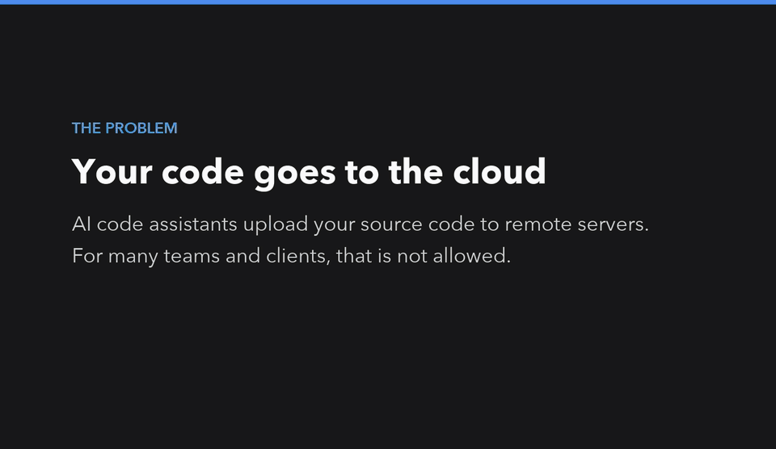

# Hushavyr — Private AI Code Review & Security Scanner for VS Code

[](https://marketplace.visualstudio.com/items?itemName=mathias82.hushavyr)
[](https://open-vsx.org/extension/mathias82/hushavyr)
[](https://marketplace.visualstudio.com/items?itemName=mathias82.hushavyr)
[](https://marketplace.visualstudio.com/items?itemName=mathias82.hushavyr&ssr=false#review-details)
[](https://github.com/mathias82/Hushavyr/actions/workflows/ci.yml)
[](LICENSE)

Hushavyr is a **free, offline AI code reviewer** and **security scanner (SAST)** for VS Code, Cursor, VSCodium and Windsurf. It runs **on your machine** with Ollama, so it is a private alternative to cloud AI code review. It finds bugs, security vulnerabilities (OWASP Top 10, SQL injection, XSS, command injection, path traversal), hardcoded secrets and vulnerable dependencies (CVEs), then explains each finding in the context of your code and **fixes it with local AI**: you see a diff and nothing changes until you approve it. It can prove a fix with a failing test and open the pull request. Your code never goes to a cloud model.

**Accuracy:** 97.2% on the [OWASP Benchmark for Java](docs/owasp-benchmark.md) and 100% on the [OWASP Benchmark for Python](docs/owasp-benchmark-python.md), both with 0% false positives. On [six real vulnerable apps](docs/real-world-benchmarks.md) (Juice Shop, WebGoat, DVWA, RailsGoat, GoVWA, WebGoat.NET) it finds SQL, NoSQL, command, path, XSS, XXE and deserialization flaws in TypeScript, Java, PHP, Ruby, Go and C#; on Juice Shop 37 of 38 HIGH findings are real.

**Works with:** Java, Kotlin, Python, JavaScript, TypeScript, Go, Rust, C#, PHP and Ruby.



▶️ [Watch in HD (MP4)](https://github.com/mathias82/Hushavyr/releases/download/v1.0.1/hushavyr-demo.mp4) · 📰 [Read the announcement on LinkedIn](https://www.linkedin.com/pulse/hushavyr-free-private-ai-code-review-security-scanner-stavrou-htyzf/)

## Why Hushavyr?

**Hushavyr** is a coined name built around **“hush”** the idea of keeping something quiet, confidential, and protected. **“-avyr”** is a distinctive invented ending, not a word with an established dictionary meaning.

The name expresses the project's privacy-first philosophy: review and improve code locally, keep sensitive information under your control, and require explicit approval before sharing anything externally.

> **Private AI. Verified Code.**  
> *Your code stays yours.*

This is a brand interpretation, not a literal translation of an existing word.

## Install

1. Install **Hushavyr** from the [VS Code Marketplace](https://marketplace.visualstudio.com/items?itemName=mathias82.hushavyr), or from [Open VSX](https://open-vsx.org/extension/mathias82/hushavyr) for VSCodium, Cursor, Windsurf and Gitpod.
2. Run **Hushavyr: Setup** from the Command Palette. You pick the model and the analyzers, confirm once, and it does the rest: installs and starts Ollama, downloads the model, and installs Semgrep, Gitleaks, Trivy, OSV-Scanner, FindSecBugs, Bandit and gosec with the Trivy and OSV offline databases. Every command is listed before anything runs; run it again after a reboot to restart Ollama (finished steps are skipped).
3. Open a project and type `@ai-privacy /review` in Chat, or run **Hushavyr: Review Current File** from the Command Palette.

## What it uses

All of these run on your machine. Setup installs the optional tools only if you agree.

| Tool | What it does in Hushavyr | Needed for |
| --- | --- | --- |
| [Ollama](https://ollama.com) + Qwen coder models | Local AI review, explanations, edits and fixes | `/review`, `/explain`, `/edit`, `/improve`, `/scan` |
| Built-in rules and data-flow tracking | Security rules for Java, Python, JS/TS, Go, Rust, C#, PHP and Ruby. Data-flow tracking follows request input (`req.query`, `$_GET`, `params[...]`, `r.FormValue`, `Request.Form`) to SQL, NoSQL, shell, eval, file, URL and HTML calls in every one of these languages. No model needed | `/security`, `/scan`, CLI |
| Built-in secrets scanner | Hardcoded passwords, keys and tokens (values are hidden) | `/secrets`, `/scan`, `/pr` |
| [Semgrep](https://semgrep.dev) (optional) | Extra rules from the bundled Hushavyr rule pack | `/security`, `/scan`, CLI |
| [Gitleaks](https://github.com/gitleaks/gitleaks) (optional) | Secret detection in the files or the whole git history; also blocks credentials before `/pr` | `/gitleaks`, `/scan`, `/pr` |
| [Trivy](https://trivy.dev) (optional) | CVEs in dependencies, plus checks whether your code calls the vulnerable function; SBOM export | `/dependencies`, `/scan` |
| [OSV-Scanner](https://google.github.io/osv-scanner/) (optional) | More dependency CVEs from a downloaded OSV.dev database; runs with `--offline`. A CVE Trivy already reports is shown once | `/dependencies`, `/scan`, CLI |
| [FindSecBugs](https://find-sec-bugs.github.io) on [SpotBugs](https://spotbugs.github.io) (optional) | Security bugs in compiled Java/Kotlin classes (`target/classes`, `build/classes/*/main`), mapped back to the source line | `/security`, `/scan`, CLI |
| [Bandit](https://bandit.readthedocs.io) (optional) | Python security checks; only medium/high severity and confidence, no `assert` or test findings | `/security`, `/scan`, CLI |
| [gosec](https://github.com/securego/gosec) (optional) | Go security checks for Go modules; no unchecked-error (G104) or test findings | `/security`, `/scan`, CLI |
| [Docker](https://www.docker.com) (optional) | Offline sandbox with no network that proves a fix: the test fails before the fix and passes after. Supports Java/Maven, Python/pytest, JS/TS and Go | **Prove with a failing test**, verified fix → PR |
| [GitHub CLI](https://cli.github.com) `gh` (optional) | Opens the pull request | `/pr`, `/improve` |
| VS Code Chat + Copilot (opt-in only) | Gets only the pseudonymized selection, and only after you approve | `/escalate`, `/auto` |

Output is SARIF 2.1.0, so GitHub code scanning and any other SARIF viewer can read it.

## Models and memory

Setup picks the model for your machine and also lists the models you already have in Ollama. Choose **Other…** to use any local Ollama model (for example `codestral`), or change `aiPrivacyRouter.ollamaModel` later. The list never comes from the internet. `aiPrivacyRouter.reviewDepth` (default `auto`) picks how many review passes run for the same memory sizes.

| Memory | Default model | Notes |
| --- | --- | --- |
| under 12 GB | `qwen2.5-coder:3b` | Light mode: one short pass with an 8k context; the built-in rules and the verifier do most of the work. Runs on 8 GB laptops. |
| 12–20 GB | `qwen2.5-coder:7b` | Fast; one pass. |
| 20–30 GB | `qwen2.5-coder:14b` | Thorough: general, security and robustness passes. |
| 30 GB or more | `qwen3-coder:30b` | Best reviews. A mixture-of-experts model (about 3B active parameters), so it is faster than the 14b. |

**Hushavyr: Start Ollama** turns on flash attention and an 8-bit KV cache, which roughly halves context memory. The deterministic commands (`/security`, `/secrets`, `/dependencies`) need no model at all, `/review` results are cached, and `/scan-changed` skips files that did not change.

## Commands

Type `@ai-privacy` in VS Code Chat, then one of these commands:

| Command | What it does |
| --- | --- |
| `/review` | Finds bugs and security issues in the open file, and checks your team rules |
| `/explain` | Explains the open or selected code |
| `/edit` | Changes the open or selected code with the local model. Follow-ups like *"can you add them"* after `/explain` also work. You see a diff and nothing changes until you click **Apply**. You can also **Try another local model** or **Escalate** (opt-in, names removed). |
| `/improve` | Asks the local model for real improvements to the open file (bugs, safety, clarity), shows a diff and a summary, and after **Apply** offers to open a pull request |
| `/pr` | Commits your changes to a new branch, pushes it and opens a pull request (`gh`, or a GitHub link). Asks first and stops if it finds credentials. |
| `/review-changes` | Reviews your uncommitted changes |
| `/scan` | Reviews the whole project: AI, Semgrep, Gitleaks, the optional analyzers, built-in rules, data flow and CVEs |
| `/scan-changed` | Same as `/scan`, but only for files that changed since the last scan |
| `/security` | Fast project security scan without AI: rules, credentials, and request input that reaches SQL, shell, eval, files or URLs |
| `/secrets` · `/gitleaks` | Finds hardcoded passwords and keys (values are hidden). `/gitleaks history` also checks every past git commit |
| `/dependencies` | Finds CVEs with Trivy and OSV-Scanner and shows whether your code calls the vulnerable function |
| `/test` | Runs the project tests |
| `/auto` | Sends a typed question that contains no code to the right model |
| `/escalate` | *Opt-in.* Sends only the selected function to a Copilot model, with names removed and after you approve it (see below) |

**Without Chat** (Cursor, Windsurf, VSCodium, or Chat turned off): the main commands are also in the Command Palette, for example **Hushavyr: Review Current File**, **Scan Project**, **Security Scan (No AI)**, **Find Hardcoded Secrets** and **Check Dependencies for CVEs**. The report opens as a Markdown preview with links to each line, and the findings appear in the **Problems** panel. *Review* and *Explain* are also in the editor's right-click menu.

**Fix a finding with local AI (AI auto-fix with approval):** use the 💡 **Fix with local AI** quick fix on any Hushavyr finding in the Problems panel (SQL injection, XSS, command injection, path traversal, hardcoded secrets, review issues), click **Fix a finding** after a Chat report, or run **Hushavyr: Fix a Finding with Local AI**. The local model writes the change, Hushavyr opens a side-by-side diff, and the file changes only after you click **Apply fix** (undo with Cmd/Ctrl+Z). Dependency CVEs use the **Upgrade** quick fix instead.

**Explain a finding with local AI:** after `/security` or `/secrets` (or their palette commands), click **Explain a finding**, or use the 💡 quick fix on any Hushavyr finding. The scanner result stays unchanged; the local model explains what it means in that exact code, whether it looks real, and suggests a minimal fix.

**Fresh CVE data:** every dependency report shows how old the Trivy and OSV databases are. If one is over a day old, Hushavyr offers **Update now**; **Hushavyr: Update Vulnerability Databases** updates both. Turn on `aiPrivacyRouter.autoUpdateVulnDb` to update daily before audits. Only the public CVE database is downloaded; your code and dependency list never leave the machine.

Quick fixes on findings:
- **Explain this finding (local AI):** context-aware explanation and a suggested fix, next to the original scanner result.
- **Fix with local AI:** on every Hushavyr finding; shows a diff, and nothing changes until you approve it.
- **Prove with a failing test:** runs a generated test in an offline Docker container (Java/Maven, Python/pytest, JavaScript/TypeScript, Go). The bug counts as confirmed only if that test fails.
- **Not a real issue:** hides the finding for the whole team.

## Team files (commit them)

| File | Purpose |
| --- | --- |
| `.hushavyr/rules.md` | Your team standards, e.g. "never log tokens". `/review` checks the code against them. |
| `.hushavyr/dismissed.json` | False positives hidden for everyone. Created by the *Not a real issue* quick fix. |
| `.hushavyr/ignore` | Paths that are never scanned, one per line (`src/test/`, `*.gen.ts`). Use it for intentionally vulnerable test fixtures. |
| `.hushavyr/taint-rules.json` | Your own request sources, sinks and sanitizers for the data-flow engine (`/scan`, `/security`, CLI), e.g. an in-house DB wrapper. |

```json
{
  "sources": [{"pattern": "\\bctx\\.input\\(", "languages": ["ts", "js"]}],
  "sinks": [{"kind": "sql", "call": "db\\.unsafeQuery", "arg": 0}],
  "sanitizers": ["toSafeId"]
}
```

Patterns are regular expressions on code (string literals are blanked); `call` and `sanitizers` name the function, `(` is added. `kind` is one of `sql`, `nosql`, `command`, `code`, `path`, `ssrf`, `xss`, `ldap`, `xpath`, `trust-boundary`, `redirect`, `xxe`, `deserialization`; `arg` is the argument index or `"all"`; `languages` are file extensions (default: all). The CLI stops with exit code 2 on an invalid file.

## CI

- **Project scan:** run `node dist/cli.js . --sarif hushavyr.sarif --fail-on high` and upload the SARIF to GitHub code scanning. See `.github/workflows/hushavyr-scan.yml`.
- **Benchmark:** results of the CLI scan on the public OWASP Benchmark for Java are in [docs/owasp-benchmark.md](docs/owasp-benchmark.md), and for Python in [docs/owasp-benchmark-python.md](docs/owasp-benchmark-python.md).
- **PR review:** copy `examples/hushavyr-pr-review.yml` into your workflows. It runs on a self-hosted runner with Ollama, reviews only the changed lines and comments on the PR.

## Hushavyr compared with cloud AI review

| | Hushavyr | Typical cloud AI code review |
| --- | --- | --- |
| Where your code goes | Stays on your machine (Ollama) | Sent to the vendor's servers |
| Price | Free, MIT licensed | Usually a subscription per seat |
| Works offline / air-gapped | Yes | No |
| Security scan without AI (rules, data flow, secrets, CVEs) | Yes | Varies |
| Proves a fix with a failing test | Yes, in an offline Docker sandbox | Rarely |
| Output for CI | SARIF, CLI exit codes, PR comments | Varies |

## FAQ

**Is Hushavyr a free GitHub Copilot alternative for code review?**
Yes, for code review and security. It works in the VS Code Chat as `@ai-privacy`, but the model runs locally with Ollama, so it is free and private. It does not replace Copilot's inline completions.

**Can it fix security vulnerabilities automatically?**
Yes, with your approval. **Fix with local AI** asks the local Ollama model for a minimal fix (a parameterized query for SQL injection, output encoding for XSS, an environment variable for a hardcoded password), shows the diff, and edits the file only after you click **Apply fix**. To be sure the fix works, **Prove with a failing test** runs a test before and after the fix in an offline Docker sandbox and can open the pull request.

**Does my code leave my computer?**
No. Review, scanning and fixes run locally, and there is no telemetry. Only the opt-in `/escalate` sends anything: a selection with names replaced by tokens, and only after you approve the exact text.

**Which model should I use?**
Setup picks one for your RAM: `qwen2.5-coder:7b` under 20 GB, `14b` for 20–30 GB, and `qwen3-coder:30b` from 30 GB up. See [Models and memory](#models-and-memory).

**Does it scan git history for leaked secrets and API keys?**
Yes, on request: `@ai-privacy /gitleaks history` or **Hushavyr: Find Secrets in Git History** runs Gitleaks over every commit, locally, with values redacted. Each finding shows the commit. A secret removed later is still exposed in history, so rotate it if it is real. Once a secret is rotated, add its fingerprint to `.gitleaksignore` and it stops being reported. Secrets in tests, fixtures, examples and docs are still reported, at lower severity.

**Will it detect a CVE published today?**
Yes, once the local CVE database is updated. Scans run offline against a downloaded copy of the public Trivy and OSV.dev databases, which are refreshed every few hours. Each report shows the database age, offers **Update now** when it is over a day old, and `aiPrivacyRouter.autoUpdateVulnDb` keeps it fresh automatically.

**Can I use it without AI?**
Yes. `/security`, `/secrets` and `/dependencies` are deterministic and need no model. The `hushavyr-scan` CLI runs the same checks in CI and writes SARIF for GitHub code scanning.

**How accurate is it?**
On our synthetic benchmark the built-in rules find every planted issue with no false alarms. On the external [OWASP Benchmark for Java](docs/owasp-benchmark.md) the scanner scores **97.2% with 0% false positives** (every category 100% except weak hashing, 69%). On the [OWASP Benchmark for Python](docs/owasp-benchmark-python.md) it scores **100% with 0% false positives**. That suite is small and formulaic, and its patterns were studied while the rules were written. Real projects are messier than any benchmark, so we also scan [six intentionally vulnerable apps](docs/real-world-benchmarks.md): OWASP Juice Shop (TypeScript), WebGoat (Java), DVWA (PHP), RailsGoat (Ruby on Rails), GoVWA (Go) and WebGoat.NET (C#). The page lists what is found, the known false positives and the misses. On [Juice Shop](docs/juice-shop-benchmark.md) 37 of 38 HIGH findings are real and test passwords are reported as MEDIUM. No tool is perfect. Findings are potential issues; check them before acting.

**Does it work in Cursor, VSCodium or Windsurf?**
Yes. Install it from [Open VSX](https://open-vsx.org/extension/mathias82/hushavyr). The `@ai-privacy` chat commands need the VS Code Chat API (VS Code 1.90 or later), which other editors may not support, but every main feature is also a Command Palette command, and the `hushavyr-scan` CLI works everywhere.

## Privacy

- Review and scanning run only on your machine. There is no automatic cloud fallback.
- `/escalate` is off unless you turn on `aiPrivacyRouter.cloudEscalation`. When it is on:
  - It sends only the selection, up to 4,000 characters.
  - Names, strings and comments are replaced with tokens such as `id1` or `s1`. The mapping stays on your machine.
  - It is blocked for secrets, personal data, `.env`/key files, ignored files and local-only workspaces.
  - You see the exact text before anything is sent, and every send is written to a local audit log.
  - The answer is a suggestion: verify it locally.
- Findings are potential issues. Check them before acting.
- No telemetry. **Hushavyr: Report an Issue** shows a redacted report (versions, OS, settings without endpoints or paths) and opens a GitHub issue only if you click it.

More details are in the [user guide](docs/guide.md). The stable API and versioning policy is in [docs/stability.md](docs/stability.md).

**Author:** Matthaios Stavrou · [GitHub](https://github.com/mathias82/Hushavyr)
